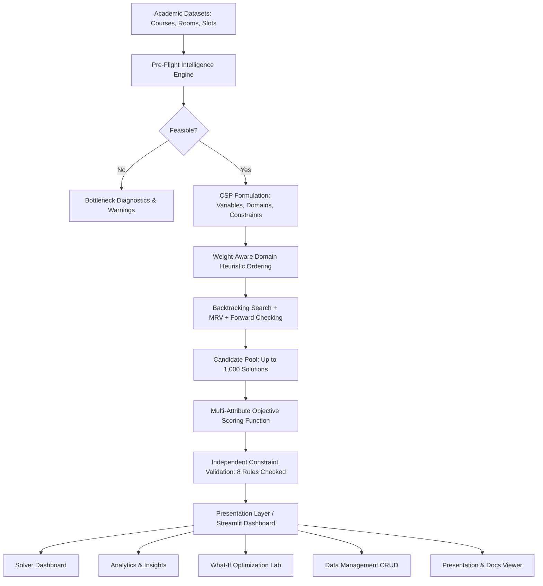

# ClassAlloc — University Classroom Allocation System
### CSP-Based Intelligent Classroom Scheduling
**Course:** Fundamentals of Artificial Intelligence (FOAI)  
**Academic Year:** 2026–27 | **Institution:** Woxsen University  
**Developer:** **Pocharam Akshaya** (Laxmi Pocharam) • Roll No: 25WU0102208

---

[](https://www.python.org/downloads/)
[](https://share.streamlit.io/)
[]()
[](https://opensource.org/licenses/MIT)

---

## 📌 Executive Summary

**ClassAlloc** is an AI-powered academic scheduling platform that automates the allocation of university course sessions to physical classrooms and weekly time slots. 

University course timetabling is a proven **NP-Hard combinatorial problem**. Manual scheduling using spreadsheets frequently results in:
* **Double-booked classrooms** and conflicting professors.
* **Severe capacity waste**, such as assigning a 15-student seminar to a 150-seat lecture auditorium.
* **Equipment mismatches**, such as scheduling a practical programming course into a hall lacking computer terminals.

ClassAlloc solves this by modeling timetabling as an exact **Constraint Satisfaction Problem (CSP)** with forward checking, minimum remaining values (MRV) heuristic ordering, and weight-aware soft constraint optimization.

---

## 🏗️ System Architecture



---

## 🧠 Mathematical Formulation

### 1. Variables ($X$)
$$X = \{c_1, c_2, \dots, c_n\} \quad (\text{Each course section requiring scheduling})$$

### 2. Domains ($D$)
For each course $c_i$, its legal domain is the set of all valid physical room and time slot tuples:
$$D(c_i) = \{(r, t) \mid r \in \text{Classrooms}, t \in \text{TimeSlots}\} \quad \text{satisfying static requirements}$$

### 3. Hard Constraints (Must NEVER be violated)
1. **Room Clash Prevention:** No physical classroom can host multiple classes at the same time slot:
   $$\forall i \neq j, \quad \text{Room}(c_i) = \text{Room}(c_j) \implies \text{Time}(c_i) \neq \text{Time}(c_j)$$
2. **Faculty Clash Prevention:** No professor can teach two courses simultaneously:
   $$\forall i \neq j, \quad \text{Faculty}(c_i) = \text{Faculty}(c_j) \implies \text{Time}(c_i) \neq \text{Time}(c_j)$$
3. **Capacity Adequacy:** Classroom seating capacity must meet or exceed student enrollment:
   $$\text{Capacity}(\text{Room}(c_i)) \ge \text{StudentCount}(c_i)$$
4. **Room Type Match:** Practical lab sessions require specialized facilities (Computer Lab, Science Lab, Seminar Room, Lecture Hall).
5. **Feature Containment:** The room must possess all required equipment:
   $$\text{RequiredFeatures}(c_i) \subseteq \text{Features}(\text{Room}(c_i))$$
6. **Operating Schedule Compatibility:** Selected slot must be within room and course availability.

### 4. Soft Constraints & Multi-Attribute Scoring Function
$$\text{Score} = 0.40 \times \text{CapacityEfficiency} + 0.20 \times \text{TimePreference} + 0.20 \times \text{FeatureEfficiency} + 0.20 \times \text{TimetableQuality}$$

* **Capacity Efficiency (40% weight):** Ratio of enrolled students to room capacity, penalizing auditorium seat wastage.
* **Time Preference (20% weight):** Rewards matching a faculty member's highest-ranked time preferences.
* **Feature Efficiency (20% weight):** Penalizes locking over-specialized rooms for simple courses.
* **Timetable Quality (20% weight):** Minimizes idle teaching gaps (>2 hours) in a faculty member's daily schedule.

---

## ⚡ Algorithmic Search Heuristics

1. **MRV (Minimum Remaining Values) Heuristic:**  
   $$\text{SelectVariable} = \arg\min_{c \in \text{Unassigned}} |\text{Domain}(c)|$$  
   Prioritizes the most constrained course first (fail-first principle), pruning unviable branches at the root of the search tree.
2. **Forward Checking:**  
   When course $c_i$ is provisionally bound to $(r, t)$, all remaining unassigned courses immediately prune $(r, t)$ and any faculty overlaps at slot $t$ from their legal domains. If any variable's domain drops to $\emptyset$, the branch is immediately abandoned.
3. **Chronological Backtracking:**  
   Restores previous domain snapshots upon reaching an unavoidable dead end.
4. **Isolated What-If Outage Engine:**  
   Simulates hypothetical room closures via deep-copied state without mutating the active baseline timetable or persistent disk storage.

---

## 📊 Application Modules

1. **Solver Dashboard:**  
   Interactive execution triggering the CSP search engine, real-time metrics, KPI cards, score breakdown with transparent loss explanations, and 4-way timetable explorer (University View, Room View, Faculty View, Section View).
2. **Analytics & Insights:**  
   Executive decision intelligence tracking classroom utilization heatmaps, faculty workload hours, day-wise distribution, and Schedule Health validation status.
3. **What-If Optimization Lab:**  
   Simulate real-world disruptions (e.g. `CR_102` air conditioning breakdown) and observe automated re-allocation deltas without corrupting baseline data.
4. **Pre-Flight Check:**  
   Static structural analysis checking resource bottlenecks and capacity bounds before solver execution.
5. **Data Management:**  
   Complete CRUD interface to manage Courses, Classrooms, and Time Slots backed by synchronized JSON storage.
6. **Presentation & Documentation:**  
   Interactive viewer of the 8 FOAI academic presentation slides, with instant one-click downloads for the original PowerPoint `.pptx`, the complete Project Based Learning Report (`.docx`), and the presentation speaking script.

---

## 🧪 Testing & Verification

The system is fortified by an automated test suite containing **91 unit and integration tests**:
```bash
python -m unittest discover -s tests -p "test_*.py"
```
**Verified Results:**
* **Test Suite:** 91 / 91 Passed (0.28s)
* **Allocation Coverage:** 100.0% (10 / 10 courses placed)
* **Hard Constraint Violations:** 0 (Validated across 8 independent rules)
* **Optimization Score:** 88.80 / 100
* **Execution Time:** ~0.015s – 0.05s

---

## 🚀 Local Installation & Quickstart

### Prerequisites
* Python 3.10, 3.11, 3.12, 3.13, or 3.14
* Git

### Setup
```bash
# Clone the repository
git clone https://github.com/akshayapocharam9-creator/ClassAlloc.git
cd ClassAlloc

# Install dependencies
pip install -r requirements.txt

# Run the Streamlit web application
python -m streamlit run app.py
```
Open **`http://localhost:8501`** in your browser.

---

## ☁️ Public Cloud Deployment (Streamlit Community Cloud)

This application is ready for 1-click free deployment on [Streamlit Community Cloud](https://share.streamlit.io/):
1. Push this repository to your GitHub account (`https://github.com/akshayapocharam9-creator/ClassAlloc`).
2. Log in to [share.streamlit.io](https://share.streamlit.io/) with your GitHub account.
3. Click **"New App"** $\rightarrow$ Select repository `ClassAlloc` $\rightarrow$ Branch `main` $\rightarrow$ Main file path `app.py`.
4. Click **"Deploy!"** Your public URL will be live within 60 seconds (e.g. `https://classalloc-akshaya.streamlit.app`).

---

## 📄 License & Credits
Developed by **Pocharam Akshaya** (Laxmi Pocharam)  
Woxsen University | Department of Computer Science & Artificial Intelligence  
Fundamentals of Artificial Intelligence (FOAI) | Academic Year 2026–27  
Licensed under the [MIT License](LICENSE).
